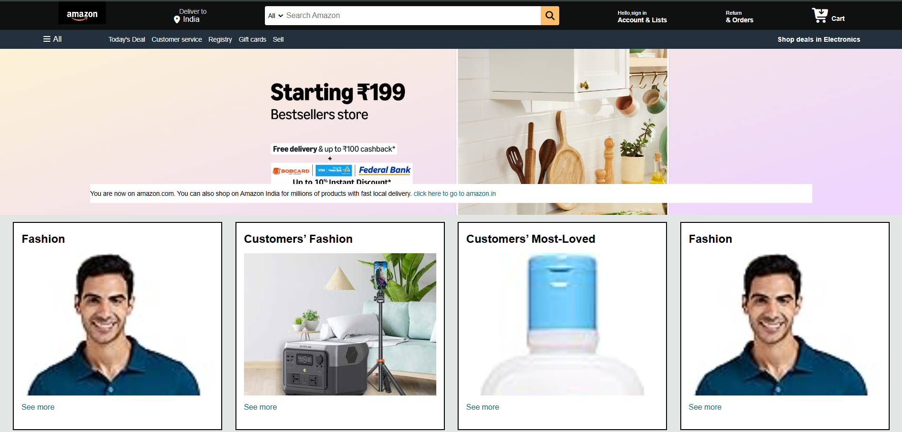
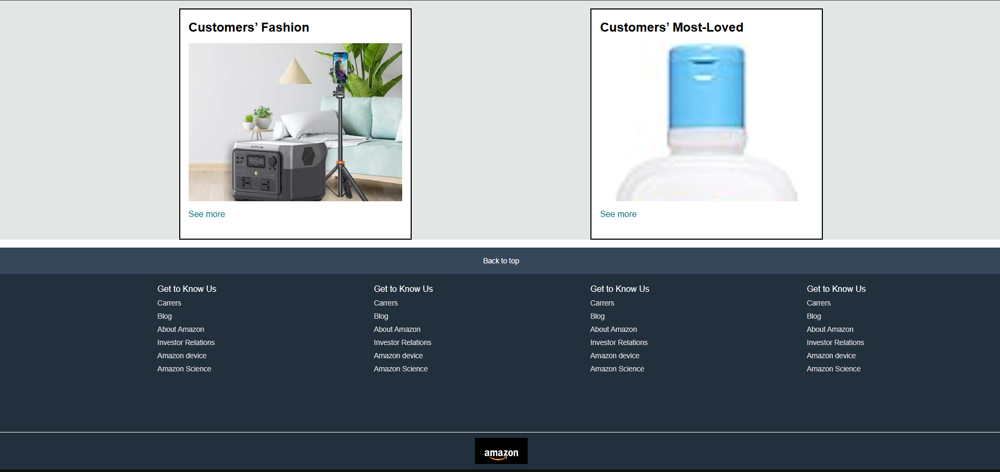

# Amazon Interface Clone

A frontend clone of the Amazon website built using HTML and CSS.

## Screenshots

### Homepage

### Products Section

## Technologies Used
- HTML5 – Website structure and content

- CSS3 – Styling, Flexbox layout, and hover effects

## How to Run
1. Clone or download this repository.
2. Open `index.html` in your browser.

## Features

1. Amazon-inspired navigation bar

2. Search bar UI

3. Delivery location and account sections

4. Product category cards

5. Hero banner and footer

